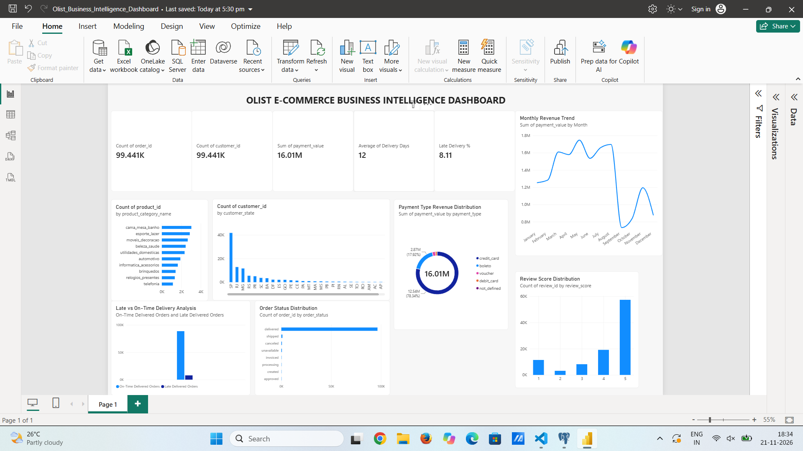

# Olist E-Commerce Business Intelligence & AI Analyst Agent

An end-to-end E-Commerce Business Intelligence and AI Analyst project that combines data analytics, PostgreSQL, Python, FastAPI, and a locally running LLM to generate data-driven business insights and recommendations.

The project transforms raw Olist Brazilian E-Commerce data into meaningful business intelligence through SQL analysis, Python, Power BI dashboards, and an AI-powered natural-language interface.

## Project Overview

This project has two major components:

1. **E-Commerce Business Intelligence:** Data cleaning, SQL analysis, Python analytics, visualizations, and an interactive Power BI dashboard.
2. **AI Analyst Agent:** A FastAPI-based application that retrieves actual business metrics from PostgreSQL and answers business questions using database-backed analysis and Ollama.

The AI Agent uses verified database results for supported business questions and Ollama (`llama3.2:1b`) for general AI-based questions. The model runs locally, avoiding paid API requirements.

## Project Objectives

- Analyze overall e-commerce business performance.
- Evaluate order and delivery performance.
- Identify seller and state-level delivery issues.
- Understand customer satisfaction and review patterns.
- Analyze products, categories, and payment methods.
- Build an interactive Power BI dashboard.
- Enable natural-language business questions through an AI Analyst Agent.
- Generate practical business recommendations from actual database findings.

## Tools & Technologies

| Category | Technologies |
|---|---|
| Programming Language | Python |
| Data Analysis | Pandas, NumPy |
| Database | PostgreSQL |
| Query Language | SQL |
| API Development | FastAPI |
| AI / LLM | Ollama, Llama 3.2 (1B) |
| Data Visualization | Matplotlib, Power BI |
| API Testing | Swagger UI |
| Development Environment | VS Code |
| Version Control | Git, GitHub |

## Dataset Overview

This project uses the publicly available Olist Brazilian E-Commerce dataset, which contains nine CSV files covering orders, customers, products, payments, reviews, sellers, and geolocation information.

**Dataset Source:** [Olist Brazilian E-Commerce Dataset – Kaggle](https://www.kaggle.com/datasets/olistbr/brazilian-ecommerce)

The original CSV files are not included in this repository. Download the dataset separately and place the files inside the `data/` folder before running the data import scripts.

### Datasets Used

- Orders
- Customers
- Order Items
- Order Payments
- Order Reviews
- Products
- Sellers
- Geolocation
- Product Category Translation

## Key Business Metrics

The following delivery and review metrics are retrieved from the PostgreSQL database:

| KPI | Result |
|---|---:|
| Total Delivered Orders | 96,470 |
| Late Delivered Orders | 7,826 |
| Late Delivery Rate | 8.11% |
| Average Delivery Time | 12.56 days |
| Average Freight per Order | R$22.79 |
| Total Customer Reviews | 99,224 |
| Average Review Score | 4.09 / 5 |
| Low-Rated Reviews (1–2 stars) | 14.69% |

*Note: Metrics depend on the underlying dataset, query definitions, and filtering conditions. Freight values are in Brazilian Real (R$).*

## Business Intelligence Analysis

### SQL Analysis

- Total orders and order status analysis
- Revenue analysis
- Monthly revenue trends
- Top-selling products
- Product category performance
- Customer distribution by state
- Payment method analysis
- Seller performance
- Delivery time analysis
- Late delivery analysis
- Customer review analysis

### Python Analysis

- Data loading and quality assessment
- Data cleaning and preprocessing
- Revenue and customer analysis
- Product and category analysis
- Monthly business performance
- Seller and delivery performance
- Customer review analysis
- Data visualization using Matplotlib

## Power BI Dashboard

An interactive Power BI dashboard was developed to monitor important business KPIs and analyze e-commerce performance.

### Dashboard Features

- KPI Cards
- Monthly Revenue Trends
- Top 10 Product Categories
- Customer State Analysis
- Payment Type Revenue Distribution
- Customer Review Score Distribution
- Order Status Distribution
- Delivery Performance Analysis

### Dashboard Preview



## AI Analyst Agent

The AI Analyst Agent extends the original Business Intelligence project by allowing users to ask business-related questions in natural language.

### Architecture

- **FastAPI:** Provides the backend API and `/chat` endpoint.
- **PostgreSQL:** Stores the Olist business data and provides actual analytical results.
- **Python:** Processes database results and generates verified business findings.
- **Ollama:** Runs the local Llama 3.2 (1B) model for general AI questions.
- **Swagger UI:** Allows users to test API endpoints.

### Key Features

- Natural-language business questions
- Database-backed business performance analysis
- Seller delivery performance analysis
- State-wise late delivery analysis
- Customer review and satisfaction analysis
- Late versus on-time delivery comparison
- Overall business performance summaries
- Practical business recommendations
- General AI questions through a locally running LLM

### Example Questions

1. Give an overall business performance summary using actual database metrics and provide five recommendations.
2. Which seller has the highest late delivery percentage?
3. Which seller state has the highest late delivery percentage?
4. Compare customer satisfaction for late and on-time deliveries.
5. What is the role of an AI analyst in e-commerce business operations?

### API Endpoint

| Method | Endpoint | Description |
|---|---|---|
| GET | `/` | Application welcome message |
| GET | `/health` | Application health check |
| POST | `/chat` | Ask business and AI-related questions |

### Run the Application

Start the FastAPI application from the project root:

```bash
uvicorn ai_agent.main:app --reload
```

Open Swagger UI in your browser:

```text
http://127.0.0.1:8000/docs
```

Example API request:

```json
{
  "question": "Give an overall business performance summary using actual database metrics and provide five recommendations."
}
```

**Note:** PostgreSQL and Ollama must be configured and running locally. Database credentials and environment variables should be configured in `.env` and must not be committed to GitHub.

## Key Business Insights

- The database contains 96,470 delivered orders.
- The overall late delivery rate is 8.11%.
- Seller state code MA has the highest late delivery percentage among the returned state results, at 23.14%.
- São Paulo (SP) has the highest order volume among the analyzed seller states.
- Late-delivery reviews have an average score of 2.57/5.
- On-time delivery reviews have an average score of 4.29/5.
- Low-rated reviews account for 14.69% of all analyzed customer reviews.

*These findings describe observed database results and do not establish that delivery delays alone cause lower customer satisfaction.*

## Project Structure

```text
Olist-Ecommerce-BI-AI-Analyst-Agent/
│
├── ai_agent/
│   ├── main.py
│   └── database.py
│
├── data/
│
├── docs/
│   └── project_report.md
│
├── sql/
│   └── business_analysis.sql
│
├── visualizations/
│   ├── customer_review_analysis.png
│   ├── customer_state_analysis.png
│   ├── delivery_performance_analysis.png
│   ├── monthly_revenue_trend.png
│   ├── payment_type_distribution.png
│   ├── power_bi_dashboard.png
│   └── top_10_categories_revenue.png
│
├── .env
├── .gitignore
├── README.md
├── Olist_Business_Intelligence_Dashboard.pbix
├── import_data.py
├── python_business_analysis.py
├── python_visualizations.py
└── test_connection.py
```

*The structure above highlights the main project files. Additional test scripts and configuration files may also be present.*

## Project Documentation

For detailed methodology, data quality checks, SQL findings, Python analysis, and dashboard details, refer to:

[Project Report](docs/project_report.md)

## Future Enhancements

- Deploy the AI Analyst Agent for online access.
- Develop a dedicated frontend chat interface.
- Add more advanced business queries and analytical capabilities.
- Automate data refresh and reporting workflows.
- Improve monitoring, logging, and API error handling.

## Conclusion

This project demonstrates practical implementation of data analytics, SQL, Python, PostgreSQL, Power BI, REST API development, and local LLM integration.

By combining traditional Business Intelligence with an AI-powered Analyst Agent, the project provides a way to explore e-commerce performance, retrieve database-backed insights, and generate actionable business recommendations.

**Project Status:** Core data analytics, PostgreSQL integration, Power BI dashboard, FastAPI backend, and local Ollama-based AI Analyst Agent implemented and functionally tested.