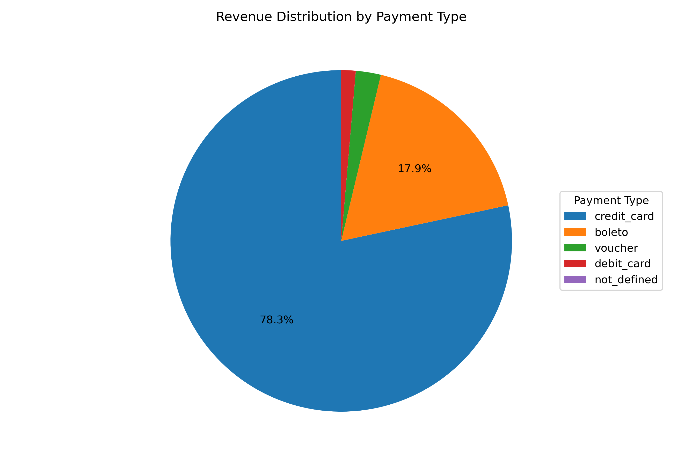

# Olist E-Commerce Business Intelligence & AI Analyst Agent

An end-to-end e-commerce data analytics project focused on analyzing business performance, customer behavior, revenue trends, product categories, payment methods, customer reviews, and delivery efficiency.

## Project Overview

The project uses the Olist e-commerce dataset to transform raw business data into meaningful insights using SQL, Python, PostgreSQL, and Power BI.

The analytics workflow includes:
- Data loading and quality assessment
- SQL-based business analysis
- Python and Pandas data analysis
- Data visualization using Matplotlib
- Interactive Power BI dashboard development

## Project Objectives

- Analyze overall e-commerce business performance.
- Identify top-performing products and categories.
- Understand customer distribution across states.
- Evaluate payment methods and revenue contribution.
- Analyze customer satisfaction and review scores.
- Measure delivery performance and late deliveries.
- Generate actionable business insights.


## Tools & Technologies

| Category | Technologies |
|---|---|
| Programming Language | Python |
| Data Analysis | Pandas |
| Database | PostgreSQL |
| Query Language | SQL |
| Data Visualization | Matplotlib, Power BI |
| Development Environment | VS Code |
| Version Control | Git, GitHub |

## Dataset Overview

This project uses the publicly available Olist Brazilian E-Commerce dataset, consisting of nine CSV files covering orders, customers, products, payments, reviews, sellers, and geolocation data.

**Dataset Source:** [Olist Brazilian E-Commerce Dataset – Kaggle](https://www.kaggle.com/datasets/olistbr/brazilian-ecommerce)

**Note:** The original CSV datasets are not included in this GitHub repository to keep it lightweight. Download the datasets separately and place the CSV files inside the `data/` folder before running the data loading scripts.

## Datasets used:
- Orders
- Customers
- Order Items
- Order Payments
- Order Reviews
- Products
- Sellers
- Geolocation
- Product Category Translation

## Key Performance Indicators

| KPI | Result |
| Total Orders | 99,441 |
| Unique Customers | 99,441 |
| Total Revenue | ₹16.01 Million |
| Average Delivery Days | 12.50 |
| Late Delivery Rate | 8.11% |

## Business Analysis

### SQL Analysis
- Total orders and unique customers
- Order status analysis
- Revenue analysis
- Monthly revenue trends
- Top 10 best-selling products
- Top 10 product categories by revenue
- Customer state analysis
- Seller performance
- Average delivery time
- Late delivery analysis
- Customer review analysis

### Python Analysis
- Revenue and customer analysis
- Monthly revenue analysis
- Product and category performance
- Customer state analysis
- Seller performance
- Delivery performance
- Customer review analysis

## Data Visualizations

Six visualizations were created using Matplotlib:

- Monthly Revenue Trend
- Top 10 Product Categories by Revenue
- Customer State Analysis
- Payment Type Revenue Distribution
- Customer Review Score Distribution
- Late vs On-Time Delivery Analysis

### Visualization Gallery

#### 1. Monthly Revenue Trend
 

#### 2. Top 10 Product Categories
 

#### 3. Customer State Analysis
 

#### 4. Payment Type Distribution
 

#### 5. Customer Review Analysis
 

#### 6. Delivery Performance
 


## Power BI Dashboard

An interactive Power BI dashboard was developed to monitor key business metrics and visualize e-commerce performance.

Dashboard includes:
- KPI Cards
- Monthly Revenue Trend
- Top 10 Product Categories
- Customer State Analysis
- Payment Type Revenue Distribution
- Customer Review Score Distribution
- Order Status Distribution
- Delivery Performance Analysis

  ### Dashboard Preview

  

## Key Business Insights

- Total revenue reached approximately ₹16.01 million.
- November 2017 recorded the highest monthly revenue.
- Health & Beauty was the highest revenue-generating category.
- São Paulo (SP) had the highest customer count.
- Credit cards were the most commonly used payment method.
- 5-star reviews represented the largest review group.
- 8.11% of delivered orders with available delivery dates were late.


## Project Structure

```text
Olist-Ecommerce-BI-AI-Analyst-Agent/
│
├── data/
│   └── load_olist_data.py
│
├── docs/
│   └── project_report.md
│
├── sql/
│   └── business_analysis.sql
│
├── visualizations/
│   ├── customer_review_analysis.png
│   ├── customer_state_analysis.png
│   ├── delivery_performance_analysis.png
│   ├── monthly_revenue_trend.png
│   ├── payment_type_distribution.png
│   ├── power_bi_dashboard.png
│   └── top_10_categories_revenue.png
│
├── .gitignore
├── README.md
├── Olist_Business_Intelligence_Dashboard.pbix
├── data_quality_report.csv
├── import_data.py
├── python_business_analysis.py
├── python_visualizations.py
└── test_connection.py
```

## Project Documentation

For detailed methodology, data quality checks, SQL findings, Python analysis, and dashboard details, see [Project Report](docs/project_report.md).

## Future Enhancements

- Integrate Claude AI for natural-language business questions.
- Build an AI-powered business analyst assistant.
- Automate analytical workflows using n8n.
- Deploy the application for live access.

## Conclusion

This project demonstrates practical experience in data analytics, SQL querying, Python programming, database management, data visualization, and business intelligence reporting.

**Project Status:** Core data analytics and Power BI dashboard completed. AI agent integration and deployment are planned future enhancements.